# Setup guide

How the pieces fit together, and what each setup asks of the A1200 itself. If your keyboard doesn't work, find your setup below, check the wiring against the diagram, then look at [troubleshooting](#troubleshooting).

The new boards are covered in their own READMEs ([adapter](../adapter/Readme.md), [encoder](../encoder/Readme.md), [din5](../din5/Readme.md)); this page is about the A1200 end and the cables.

## Three ways to connect

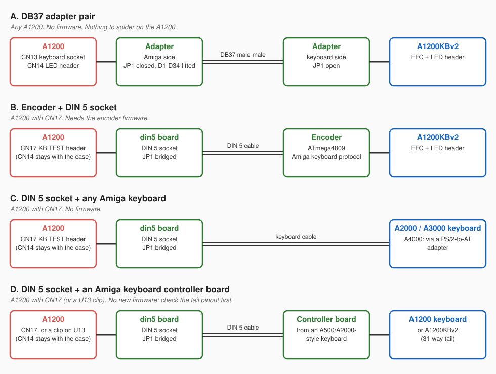

| | A. DB37 adapter pair | B. Encoder + DIN 5 socket | C. DIN 5 socket + Amiga keyboard | D. DIN 5 socket + keyboard controller board |
|---|---|---|---|---|
| Soldering on the A1200 | none | only if CN17 has no header fitted (or use a U13 clip) | as B | as B |
| A1200 connectors used | CN13 (keyboard ribbon) and CN14 (LEDs) | CN17 | CN17 | CN17 |
| A1200's keyboard controller (U13) | does the work, as normal | held in reset by the din5 board | held in reset by the din5 board | held in reset by the din5 board |
| Keyboard LEDs | power, floppy, disk, Caps Lock | power and Caps Lock | the keyboard's own | depends on the controller board |
| Firmware | none | encoder firmware | none | the controller board's own |
| Which A1200s | any | boards with CN17, or any with a U13 clip | as B | as B |

No setup cuts tracks or removes chips on the A1200. The only possible modification is fitting a 7-pin header to CN17 (setups B, C and D) if your board has the pads but no header, and a [clip on U13](#no-cn17-clip-onto-u13) avoids even that.

### The A1200 connectors

The names come from the Commodore A1200 schematic ([amigawiki.org](https://www.amigawiki.org/dnl/schematics/A1200_R1.pdf), sheet 9, "keyboard MPU").

- **CN13**: the keyboard ribbon (membrane) socket, 31 ways. The original keyboard's tail plugs in here. Every line is a raw matrix row or column scanned by U13, the 68HC05 keyboard controller on the motherboard.
- **CN14**: the 5-pin LED header: 1 power LED, 2 floppy LED, 3 IDE LED, 4 CC (its driver is marked optional on the schematic), 5 GND. Pins 1-4 are driven high through PNP transistors straight from VCC.
- **CN17** "KB TEST": 7 pins, 1 KB_DATA, 2 KB_CLOCK, 3 KB_RESET, 4 U13 reset, 5 NC, 6 VCC, 7 GND. These are U13's outputs to the rest of the Amiga, the serial keyboard lines every other Amiga has on its keyboard socket. Grounding pin 4 holds U13 in reset, which frees the lines for an external keyboard. The schematic marks CN17 "new on Rev 1E PCB", so older boards may not have it.

<!-- Photos of CN13, CN14 and CN17 on a real board belong here: docs/images/a1200-connectors.jpg -->

## A. DB37 adapter pair

The same adapter board is used at both ends, joined by a straight-through DB37 male-to-male cable. The Amiga-side board has its ESD diodes fitted and JP1 closed (shell to ground); the keyboard-side board leaves JP1 open.

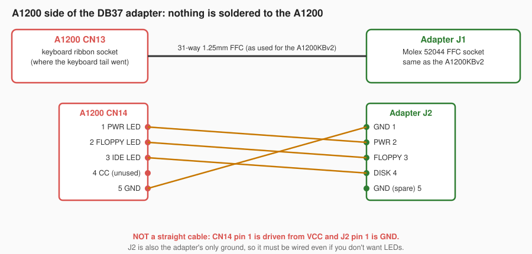

On the A1200:

1. Unplug the original keyboard from CN13 and the LED board from CN14.
2. Connect CN13 to the adapter's J1 with a 31-way 1.25mm FFC, the same kind of cable as the A1200KBv2 uses.
3. Wire CN14 to the adapter's J2 as in the diagram. This is **not** a straight 5-way cable: the A1200 and the adapter number these pins differently, and a straight cable puts the power LED driver on ground.

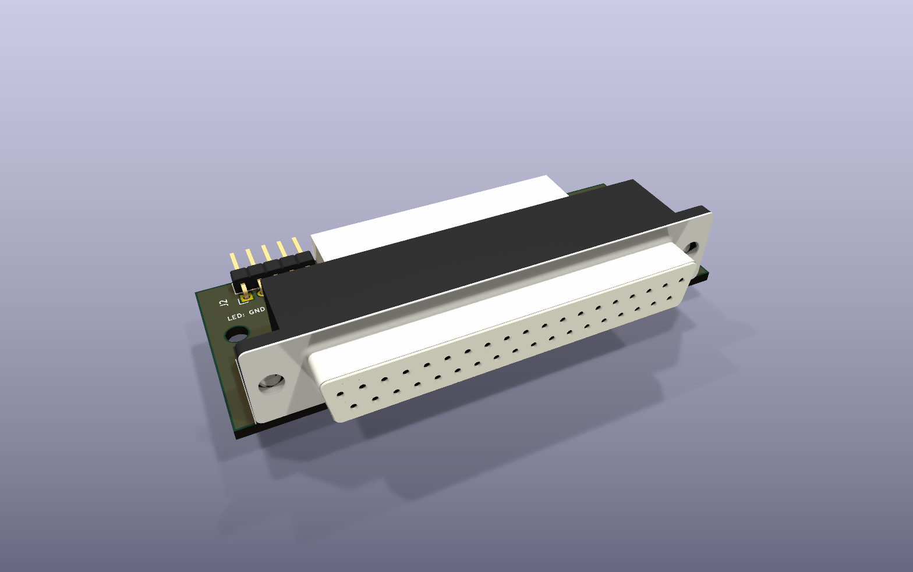

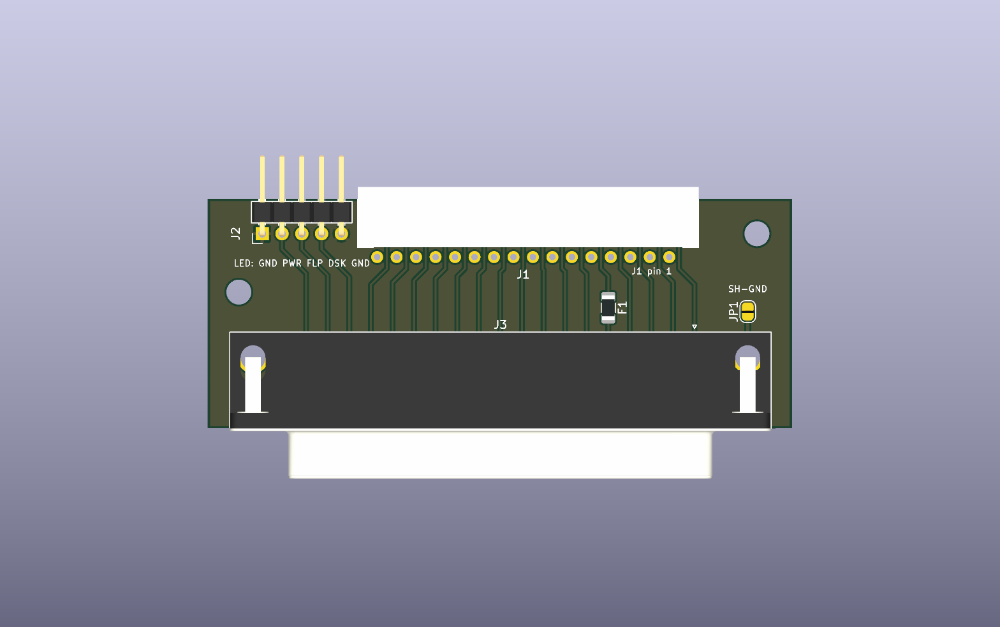

J1 (the white FFC socket) faces away from the DB37, with its opening over the top edge. J2 is the 5-pin LED header on the left.

## B, C and D. DIN 5 socket on CN17

The din5 board gives the A1200 a standard Amiga keyboard socket, wired like an A2000 or A3000. Plug in the A1200KBv2 with the encoder (B), an A2000/A3000 keyboard, or an A4000 keyboard through a passive PS/2-to-AT adapter (C), or an A1200 keyboard on a keyboard controller board (D).

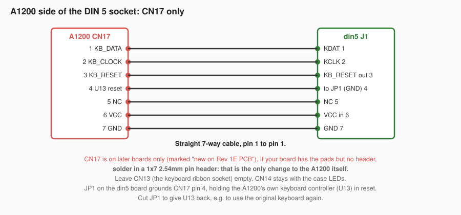

On the A1200:

1. Find CN17. If there are pads but no pins, solder in a 1x7 2.54mm pin header.
2. Unplug the original keyboard from CN13 and leave CN13 empty.
3. Connect CN17 to the din5 board's J1 with a straight 7-way jumper cable, pin 1 to pin 1.
4. Leave CN14 for the case's own LEDs; the din5 board doesn't use it.

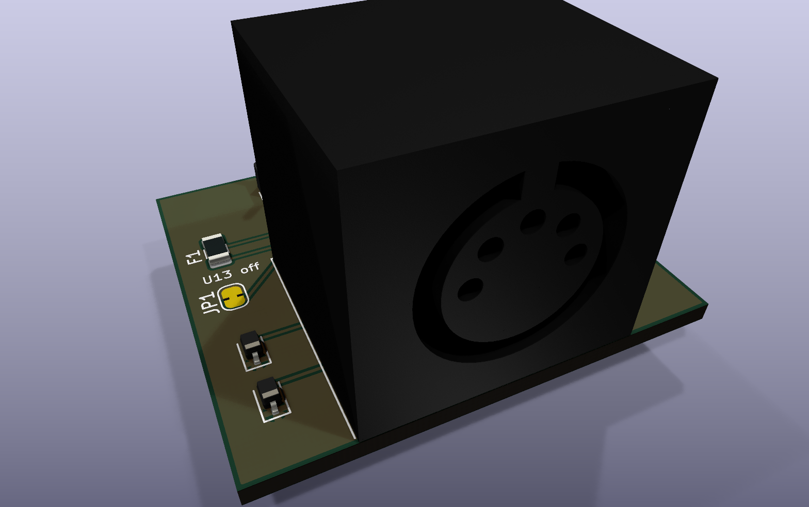

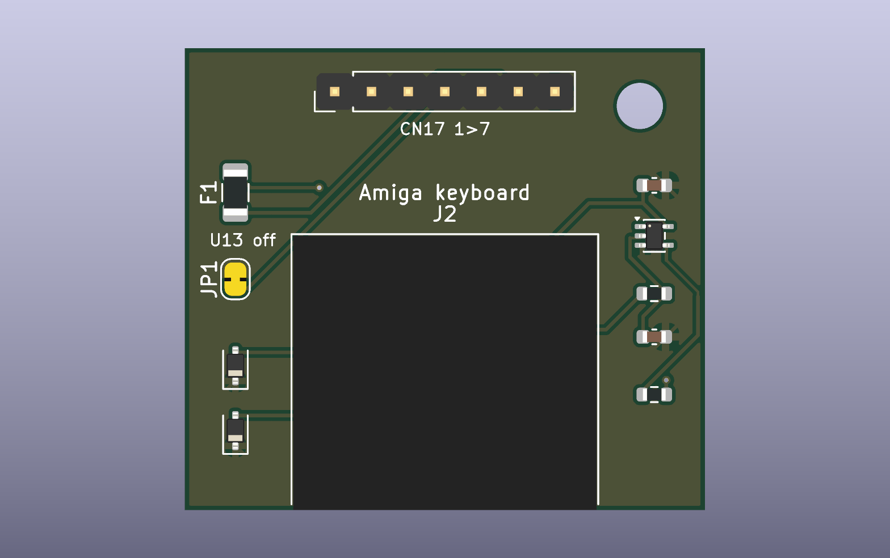

JP1 (the yellow pad, left) is bridged as made: it grounds CN17 pin 4 and keeps U13 in reset. Cut the bridge to give U13 back, for example to go back to the original keyboard on CN13. The small chip on the right (U1) turns a standard keyboard's reset request (clock held low for half a second) into the A1200's KB_RESET.

## D. Keyboard controller board

The A1200 keyboard (or the A1200KBv2, which has the same 31-way tail) plugs into the controller board from an A500 or A2000/A3000/A4000-style keyboard, and that board's DIN 5 cable goes to the din5 board on the A1200, as in setup C. The controller board does the scanning and speaks the Amiga keyboard protocol, so no new firmware is needed, and it makes the standard reset request that the din5 board turns into KB_RESET.

Before you rely on it:

- Check that the A1200 tail's 31 lines match the controller board's matrix connector pin for pin. This project hasn't verified that, and the boards differ in their LED wiring.
- The A1200 keyboard's Caps Lock LED runs from VCC (tail pin 9) into /CAPSLOCK (tail pin 31); whether it lights depends on how the controller board drives its own LED.
- The controller board is powered from DIN 5 pin 5, through the din5 board's 500mA fuse.

## No CN17: clip onto U13

Everything CN17 brings out comes straight off U13, the A1200's 68HC05 keyboard controller. Instead of soldering a header, a PLCC clip or piggyback socket on U13 can pick up the same six signals and bring them out on a 1x7 header in CN17 order. The din5 board then plugs in unchanged.

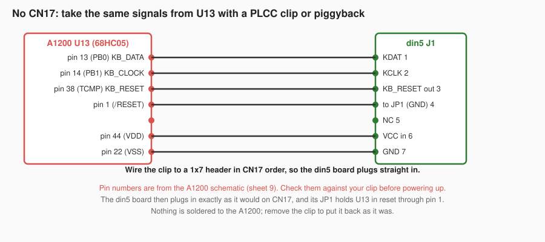

## Keyboard side

The A1200KBv2 connects the same way to either the DB37 adapter or the encoder.

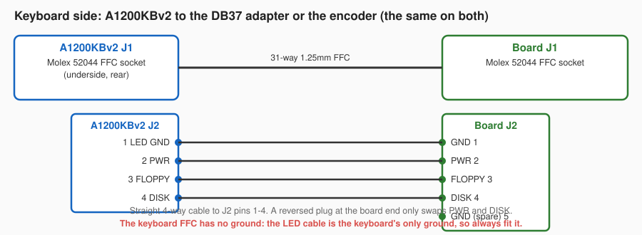

The keyboard ribbon has no ground pin. Ground reaches the keyboard only through the LED cable, so fit it even if you don't care about LEDs: the Caps Lock LED inverter on the keyboard runs from it.

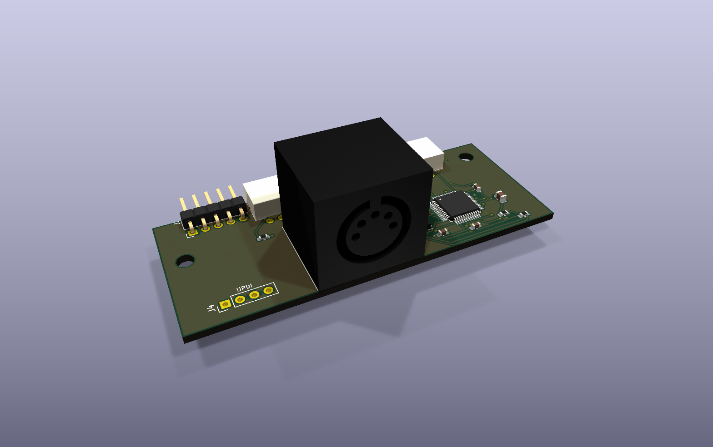

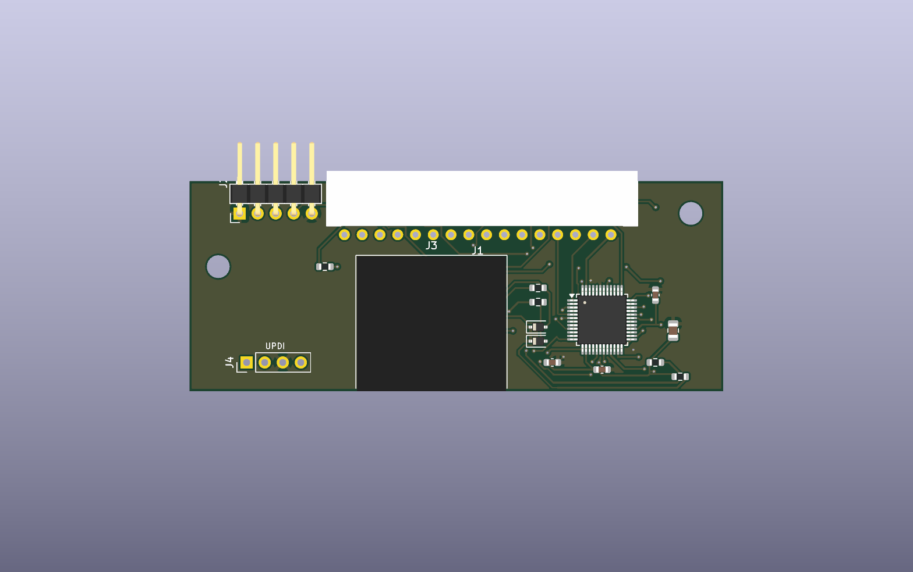

The encoder has the same outline, mounting holes, J1 and J2 as the DB37 adapter, so it sits in the same place in the case. J4 (UPDI) programs the ATmega4809.

## The case

A low wedge tray and lid, each split in two to fit a 256mm print bed. STLs from the current settings are in [`case/stl/`](../case/stl), but some dimensions are still estimates until checked on a built keyboard; see the [case README](../case/Readme.md) for printing and hardware.

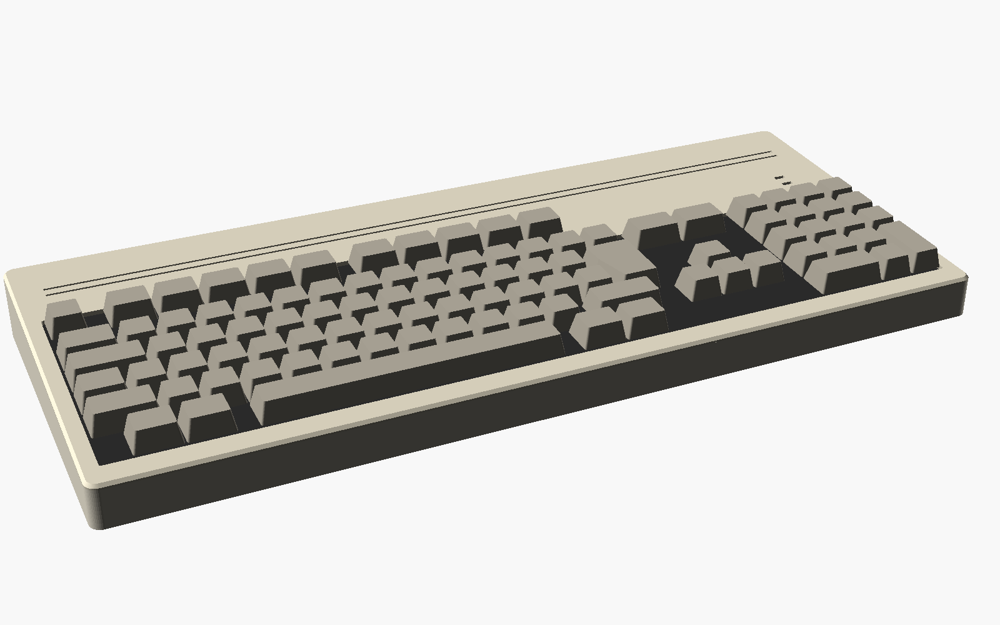

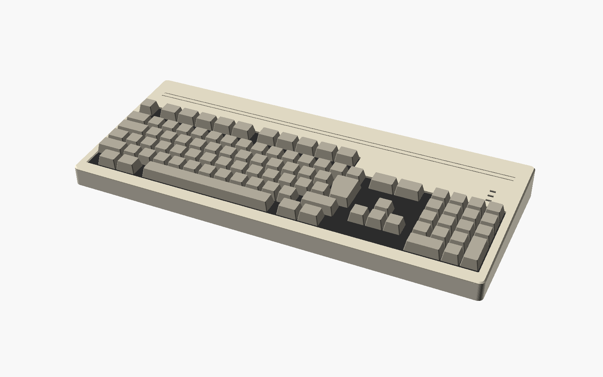

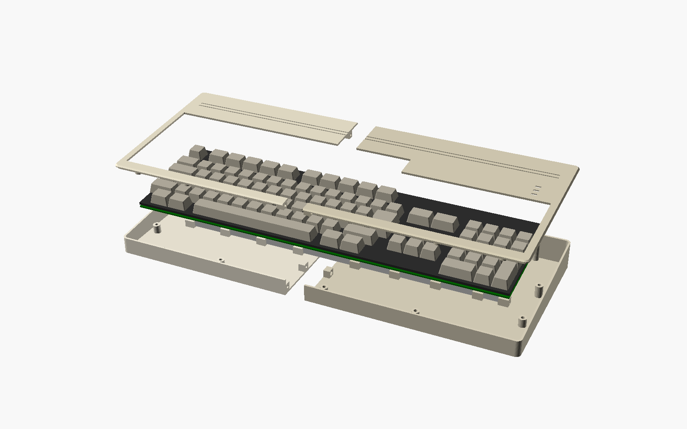

From the bottom: the two tray halves (bolted together through blocks at the split), the aluminium stiffening bar, the rear board, the keyboard on its posts, and the two lid halves. The keyboard screws down through its own PCB holes; with its A1200 mounting brackets fitted it drops straight in, without them it takes the printed spacers.

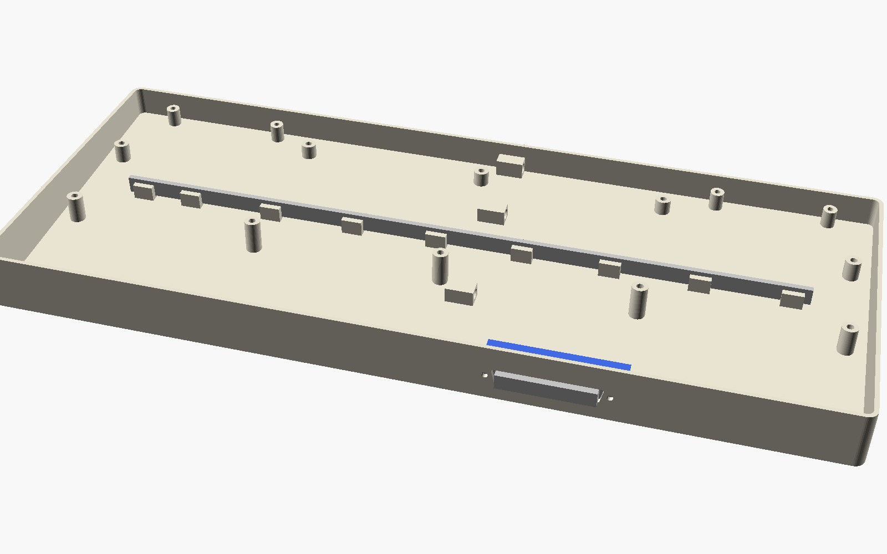

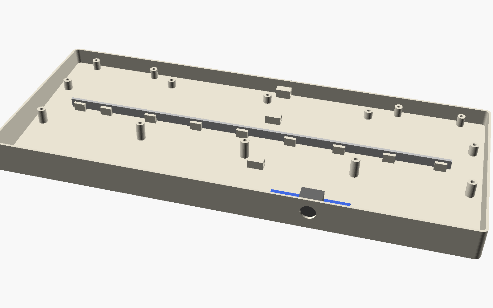

Inside the tray, from the rear: the posts for the keyboard and lid, the bar standing on edge in its ribs, and the rear board (blue) against the rear wall behind the keyboard's FFC connector. `link` in `case/a1200kb-case.scad` chooses the D cut-out (DB37 adapter) or the round one (DIN 5 encoder).

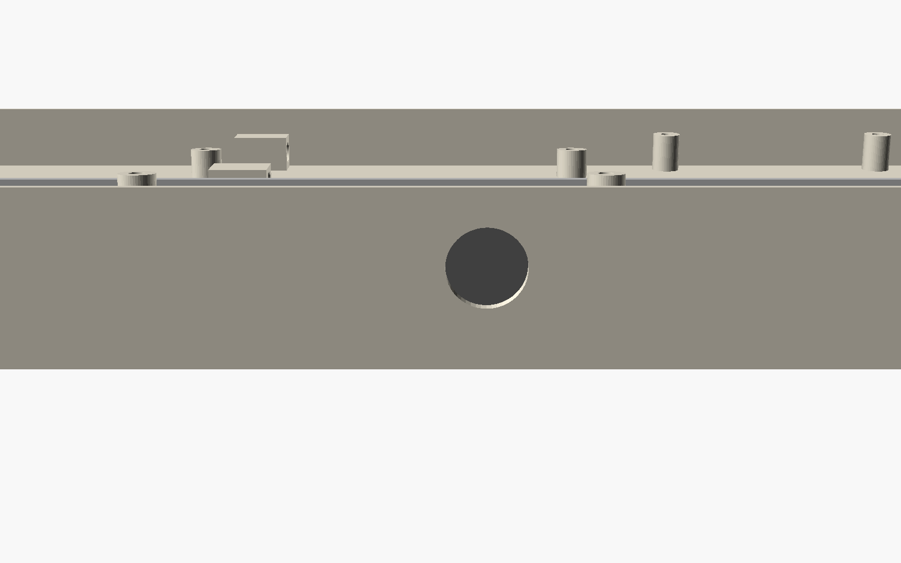

## Troubleshooting

| Symptom | Setup | Likely cause |
|---|---|---|
| No keys at all | A | FFC cable at CN13 or J1 in the wrong way round or not fully seated; DB37 cable not straight-through. |
| No keys at all | B, C, D | CN17 cable (or U13 clip wiring) offset or reversed (pin 1 to pin 1); JP1 cut, so U13 still drives the lines; a DIN cable with only three wires (many MIDI cables). |
| No keys at all | B | Encoder not programmed. |
| No keys, or the wrong keys | D | The A1200 tail and the controller board's connector don't match pin for pin. |
| A1200's power LED driver gets hot, power LED dead | A | Straight cable on CN14: use the remapped wiring above. |
| Keyboard LEDs dead, or power LED doesn't turn blue with Caps Lock | A, B | LED cable to the keyboard's J2 missing or reversed; it is also the keyboard's only ground. |
| Keys work, Ctrl-Amiga-Amiga doesn't reset | B, C, D | The keyboard isn't holding the clock low long enough (about 225ms is needed; the standard is 500ms), so check the encoder firmware (B). On the din5 board, check U1, R1 and C1. |
| A1200 stays in reset, or resets on its own | B, C, D | KB_RESET is active-low on your board, the opposite of what the din5 board assumes: fit a 74LVC1G17 for U1. |
| Phantom keys when holding several at once | A, B | Expected with this matrix: like the original A1200 keyboard it has no diodes, so some combinations of three or more keys can't be told apart. |

## Regenerating the images

`docs/render.sh` rebuilds everything in `docs/images/`: the wiring diagrams (`docs/diagrams.py`), the KiCad 3D renders and the OpenSCAD case views. The FFC socket and DIN 5 3D models in `lib/A1200KB.3dshapes/` are simplified shapes, there to show what plugs in where.
